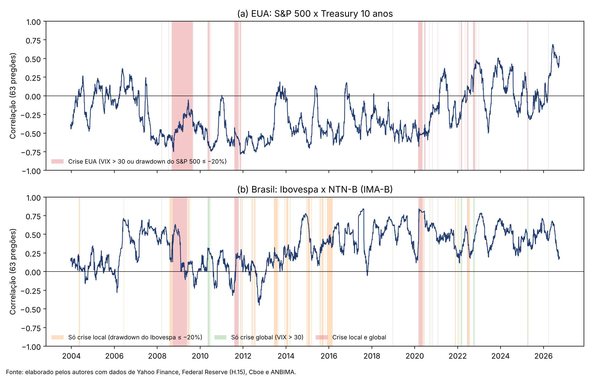
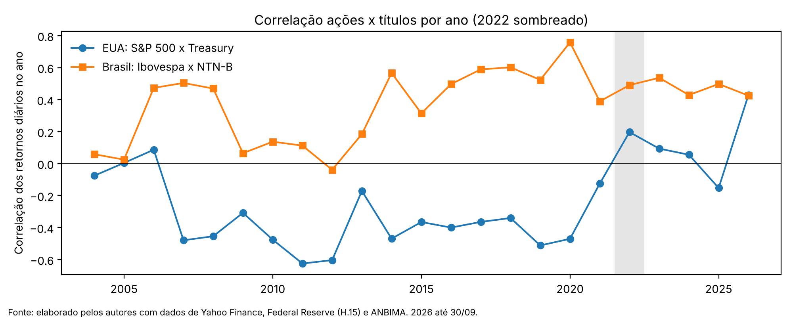

# 1 INTRODUÇÃO (rascunho v3: problema, pergunta de pesquisa e justificativa)

## 1.1 Contextualização e problema de pesquisa

Em momentos de crise, investidores costumam vender ativos de risco e buscar proteção em ativos considerados seguros. Esse movimento, conhecido na literatura como *flight to quality* ou *flight to safety*, tem no título público de referência, como o Treasury norte-americano, o ativo seguro e líquido típico (BAELE et al., 2020). Como consequência, espera-se que a correlação entre os retornos de ações e desses títulos se torne negativa justamente quando a proteção é mais necessária. Nos dias de *flight to safety* em países desenvolvidos, essa correlação chega a −58,5% em média (BAELE et al., 2020), mas o padrão não aparece em todas as crises: nos Estados Unidos, Baur e Lucey (2009) o encontram em duas de seis crises entre 1997 e 2002.

Essa relação também não é fixa ao longo do tempo. A covariância entre ações e Treasuries foi positiva no início dos anos 1980, de inflação alta, e negativa nos anos 2000, sobretudo nas recessões de 2001 e de 2007 a 2009 (CAMPBELL; SUNDERAM; VICEIRA, 2017). Até 2022, a correlação voltou a subir nos Estados Unidos e na zona do euro, em um ambiente de inflação elevada e de aperto monetário (MOSK; PANGALLO; ZEMA, 2022). Esses episódios reforçam a visão de que o sinal da correlação depende do ambiente: a maior aversão a risco tende a reduzir a correlação, enquanto a inflação alta tende a torná-la positiva (MOLENAAR et al., 2024; MOSK; PANGALLO; ZEMA, 2022).

No caso de economias emergentes, há um elemento adicional. O título público carrega risco soberano e, quando esse risco é alto, deixa de funcionar como proteção. Na zona do euro, os títulos dos países de maior risco passaram a se mover junto com as ações durante a crise da dívida soberana (DUFOUR; STANCU; VAROTTO, 2017). Nos emergentes, a depreciação cambial vem acompanhada de saída de investidores estrangeiros e de alta do prêmio de risco de crédito dos títulos em moeda local (HOFMANN; SHIM; SHIN, 2020). No Brasil, portanto, não é evidente que a NTN-B cumpra o mesmo papel de proteção que o Treasury exerce nos Estados Unidos.

O problema de pesquisa surge desse contraste. A teoria de *flight to quality* foi construída e testada, em sua maior parte, com dados de mercados desenvolvidos, e sua validade para um país com risco soberano relevante permanece pouco explorada.

## 1.2 Pergunta de pesquisa

**Pergunta principal:**

> A correlação entre os retornos de ações e de títulos públicos torna-se negativa em períodos de crise, como prevê a hipótese de *flight to quality*, e esse padrão observado nos Estados Unidos se repete no Brasil, ou o risco-país faz o título público brasileiro reagir de forma distinta do Treasury?

A pergunta principal se desdobra em quatro questões específicas, cada uma associada a uma proposição derivada da revisão de literatura (seção 2.3):

- **Q1 (EUA, crises de aversão a risco):** a correlação entre S&P 500 e Treasury é significativamente mais negativa em crises do que em períodos normais? *(testa P1)*
- **Q2 (intensidade da incerteza):** a correlação entre S&P 500 e Treasury diminui à medida que o VIX aumenta, e essa relação se enfraquece ou se inverte no caso de Ibovespa e NTN-B? *(testa P2)*
- **Q3 (Brasil, risco-país):** em crises, a correlação entre Ibovespa e NTN-B é positiva, indicando que o título doméstico se comporta como ativo de risco, e esse resultado se mantém após o controle pela taxa de câmbio? *(testa P3)*
- **Q4 (Brasil, origem da crise):** a correlação entre Ibovespa e NTN-B é mais positiva em crises de origem local do que em crises de origem global? *(testa P4)*

As proposições correspondentes são:

- **P1:** nos EUA, a correlação entre ações e Treasury é negativa em crises de aversão a risco (BAUR; LUCEY, 2009; BAELE et al., 2020).
- **P2:** nos EUA, a correlação entre ações e títulos diminui à medida que a incerteza do mercado acionário aumenta (CONNOLLY; STIVERS; SUN, 2005; OHMI; OKIMOTO, 2016). Não se espera esse padrão no Brasil, já que, em países com títulos considerados mais arriscados, a correlação tende a ser mais positiva e menos ligada aos fatores que a explicam nos EUA (MOLENAAR et al., 2024; OHMI; OKIMOTO, 2016).
- **P3:** no Brasil, o título público doméstico se comporta como ativo de risco em crises, mesmo controlando pela taxa de câmbio (DUFOUR; STANCU; VAROTTO, 2017; HOFMANN; SHIM; SHIN, 2020; MOLENAAR et al., 2024).
- **P4:** o comportamento de ativo de risco da NTN-B é mais intenso quando a crise decorre de fatores domésticos, que elevam diretamente o risco-país. A proposição é inspirada em Dufour, Stancu e Varotto (2017): na zona do euro, o título dos países de maior risco seguiu protegendo a carteira na crise de 2008, de origem externa, e só passou a se mover com as ações na crise da dívida soberana, que elevou o risco de crédito desses países.

O episódio de 2021 e 2022, marcado por choque de inflação e aperto monetário, será tratado como análise exploratória e descritiva, sem proposição formal associada.

## 1.3 Justificativa

A relação entre ações e títulos públicos sustenta a diversificação de carteiras, mas a evidência mostra que ela é instável e depende do emissor. Dufour, Stancu e Varotto (2017) mostram que, na zona do euro, os títulos de países de maior risco perderam o status de ativo seguro durante a crise da dívida soberana, e Ohmi e Okimoto (2016) encontram, para Itália, Portugal e Espanha, a passagem para correlação positiva logo no início dessa crise. Entender em que condições o título público protege uma carteira torna-se relevante tanto para a teoria de alocação de ativos quanto para a gestão de risco em países emergentes.

Para o Brasil, a evidência ainda é escassa e não trata de crises com títulos domésticos em frequência diária. Cardoso e Garcia (2023) documentam comovimento positivo entre títulos e ações de 2015 ao início de 2020, medido por betas de regressão com retornos em horizonte anual e sem condicionar a análise a episódios de crise. Molenaar et al. (2024) incluem o Brasil entre cinco emergentes, com dados mensais, e mostram que inflação e juro real praticamente não explicam a correlação no país. Bianconi, Yoshino e Machado de Sousa (2013) estudam os BRIC na crise de 2008 com o EMBI, índice da dívida externa em dólar, e não com títulos domésticos. Silva, Bertella e Pereira (2014) relacionam o Ibovespa ao risco-país medido pelo EMBI-BR, sem analisar títulos públicos domésticos. Este estudo contribui ao testar diretamente a hipótese de *flight to quality* com a NTN-B, em frequência diária e distinguindo crises globais e locais.

A escolha dos casos segue a lógica de replicação teórica do estudo de caso (YIN, 2015). Os Estados Unidos são o caso de referência, pois é nesse mercado que a hipótese de *flight to quality* foi formulada e mais testada. O Brasil é o caso contrastante: tem mercado acionário e de títulos públicos indexados à inflação com séries diárias públicas, ciclo monetário próprio e exposição recorrente a episódios de risco-país. Se a teoria estiver correta, os dois casos devem produzir resultados opostos por razões previsíveis, o que reforça a explicação em vez de enfraquecê-la.

Os resultados interessam a gestores de fundos, entidades de previdência e investidores individuais que mantêm carteiras "balanceadas" entre ações e renda fixa doméstica, pois indicam se essa combinação oferece proteção nas crises ou se a proteção precisa vir do câmbio ou de ativos externos. A validação ocorre em três frentes: testes formais de diferença entre correlações (z de Fisher e bootstrap em blocos), análises de robustez com janelas, limiares e índices alternativos, e reprodutibilidade integral, com dados públicos (Federal Reserve, Cboe, Yahoo Finance, ANBIMA e Banco Central) e código aberto. Como a correlação sobe mecanicamente quando a volatilidade aumenta (FORBES; RIGOBON, 2002), o ajuste para esse viés entra como teste de robustez.

# 2 REVISÃO DA LITERATURA (rascunho v1)

## 2.1 Flight to quality e incerteza nos EUA

Baur e Lucey (2009, p. 341) definem *flight to quality* como a queda significativa da correlação entre ações e títulos públicos em uma crise do mercado acionário, desde que a correlação resultante seja negativa. Se ela cai, mas continua positiva, há apenas desacoplamento. Baele et al. (2020, p. 690) acrescentam o estresse de mercado e identificam os dias de *flight to safety* pela alta do título, pela queda das ações e pela correlação negativa entre os dois. Nesses dias, a correlação média em 23 países desenvolvidos é de −58,5%, contra −4,18% nos demais (BAELE et al., 2020, p. 702-703).

O padrão, contudo, não aparece em toda crise e dura pouco. Nos Estados Unidos, Baur e Lucey (2009, p. 350) encontram fuga para os títulos em apenas duas de seis crises entre 1997 e 2002, e as fugas perdem significância quando a janela de crise passa de 20 pregões (p. 351). Em Baele et al. (2020, p. 710-713), 62% dos episódios duram um único dia e só 21,6% coincidem com os dias de maior volatilidade das ações. Por isso, o resultado depende da janela e do critério de crise, o que justifica testar alternativas para ambos. Dessa literatura decorre a P1: nos EUA, a correlação entre ações e Treasury é negativa em crises de aversão a risco.

A incerteza também pode ser tratada como variável contínua. Connolly, Stivers e Sun (2005) mostram que, entre 1986 e 2000, a correlação entre ações e Treasury de 10 anos nos 22 pregões seguintes diminui à medida que o VIX sobe: a média cai de 0,340 na amostra completa para 0,079 quando o índice supera 30. Com outro método e dados até 2012, Ohmi e Okimoto (2016) obtêm o mesmo resultado nos EUA, na Alemanha e no Reino Unido: VIX alto desloca a correlação para um regime negativo, mesmo após controlar pela tendência de queda da correlação no período. A correlação diminui com a incerteza, mas não precisa ficar negativa, já que a média de Connolly, Stivers e Sun (2005) segue positiva com VIX acima de 30.

Essa evidência sustenta a P2 na parte referente aos EUA: a correlação entre ações e títulos diminui à medida que o VIX aumenta. A relação, porém, parece depender de o título ser visto como seguro. Em Portugal e na Espanha, países de maior risco de crédito, Ohmi e Okimoto (2016) não encontram papel para o VIX na mudança de regime, e a correlação passa a ser positiva com a crise do euro. Essa diferença fundamenta a expectativa de que o padrão não se repita no Brasil, ponto retomado na seção 2.2.

## 2.2 Natureza do choque, risco soberano e o caso brasileiro

O sinal da relação entre ações e Treasuries também muda com o regime macroeconômico. O beta dos Treasuries em relação às ações ficou perto de 0,4 entre 1980 e 2000 e perto de −0,2 depois, com os valores mais negativos nas recessões de 2001 e de 2007 a 2009 (CAMPBELL; SUNDERAM; VICEIRA, 2017, p. 265-266), e a correlação passou de 0,35 entre 1970 e 1999 para −0,29 entre 2000 e 2023 (MOLENAAR et al., 2024, p. 17). Dois efeitos de sentido oposto explicam esse movimento: a aversão a risco reduz a correlação quando os títulos são vistos como porto seguro, e a inflação alta a torna positiva (MOLENAAR et al., 2024, p. 20). Mosk, Pangallo e Zema (2022) encontram os dois na mesma regressão para a zona do euro, com efeito não linear da inflação e mínimo perto de 2%, e associam a alta recente da correlação à inflação e ao aperto monetário. Por isso, o episódio de 2022 é tratado neste estudo como análise exploratória.

Há ainda um problema de medida que afeta todas as proposições. Forbes e Rigobon (2002, p. 2223) mostram que o coeficiente de correlação depende da volatilidade do mercado: em seu exemplo, com a mesma relação entre dois mercados, a correlação estimada sobe de 10% para 71% apenas porque a variância de um deles aumenta (p. 2230-2231). Os autores propõem um ajuste para esse viés, mas ele só é válido sem choques globais comuns e sem efeito de retorno entre os mercados (p. 2234), condições pouco plausíveis nas crises analisadas aqui. Por isso, o ajuste entra como teste de robustez, e o viés é discutido como limitação.

A condição de o título ser visto como seguro deixa de valer quando o risco de crédito do emissor é alto: o título passa a reagir às mesmas notícias que as ações e deixa de proteger a carteira. Dufour, Stancu e Varotto (2017) mostram isso na zona do euro: nos países de maior risco, o beta do título em relação às ações passa de −0,039 na crise de 2008 para +0,096 e +0,171 nas duas fases da crise da dívida soberana, e o sinal muda quando o CDS soberano de 5 anos supera 2%. Ohmi e Okimoto (2016) datam a passagem da correlação para valores positivos na Itália, em Portugal e na Espanha entre dezembro de 2009 e janeiro de 2010. Como esses países compartilham a moeda, a evidência não inclui o risco cambial, que é central no caso brasileiro.

Nas economias emergentes, o câmbio reforça esse mecanismo. Hofmann, Shim e Shin (2020) mostram que a depreciação da moeda local contra o dólar eleva o prêmio de risco de crédito dos títulos soberanos em moeda local, cerca de 10 pontos-base para cada 1% de câmbio, e que o câmbio relevante é o bilateral contra o dólar. Baele et al. (2020, p. 726, 731) concluem que os títulos soberanos de emergentes em dólar se comportam como ativos de risco nos episódios globais de *flight to safety*, e Molenaar et al. (2024, p. 30) observam que, onde o título é visto como mais arriscado, a correlação com as ações é mais positiva e pouco ligada a inflação e juro real. Daí decorrem a P3, segundo a qual a NTN-B se comporta como ativo de risco em crises mesmo com controle pelo câmbio USD/BRL, e a parte da P2 que não espera, no Brasil, a queda da correlação com o VIX observada nos EUA.

A origem da crise também parece importar. Na zona do euro, o título dos países de maior risco continuou com beta negativo na crise de 2008, de origem externa, e só passou a se mover com as ações na crise soberana, que elevou diretamente o risco de crédito desses países (DUFOUR; STANCU; VAROTTO, 2017). Esse contraste inspira a P4: o comportamento de ativo de risco da NTN-B deve ser mais intenso em crises de origem doméstica do que em crises globais. A base é indireta, pois os autores não classificam as crises pela origem, e a crise soberana europeia foi regional, não estritamente doméstica.

Para o Brasil, a evidência é escassa e não trata de crises. Cardoso e Garcia (2023, p. 3, 14) encontram beta positivo entre títulos públicos e ações de 2015 ao início de 2020 e mostram que o risco-país move os dois na mesma direção, mas com retornos anuais e sem condicionar a análise a crises. Molenaar et al. (2024, p. 25) usam dados mensais, e Bianconi, Yoshino e Machado de Sousa (2013, p. 80), o EMBI em dólar, enquanto Silva, Bertella e Pereira (2014) e Martínez Arroyo e Marín Rodríguez (2021) tratam do risco-país sem analisar a relação entre ações e títulos domésticos. A busca, feita em buscadores acadêmicos gerais e no SciELO, não encontrou estudo que teste essa relação no Brasil em crises, com dados diários e distinguindo a origem do choque, lacuna que este estudo ocupa ao comparar Ibovespa e NTN-B com S&P 500 e Treasury.

## 2.3 Síntese

O Quadro 1 reúne as proposições, as referências que as sustentam e o resultado esperado em cada caso. A base é direta para a P1, para a P2 nos EUA e para a P3, e indireta para a P2 no Brasil e para a P4, que dependem de evidências da zona do euro e de amostras com dados mensais. Seguindo a lógica de replicação teórica (YIN, 2015), espera-se que os dois casos produzam resultados opostos pelas razões previstas: proteção do título nas crises dos EUA e comportamento de ativo de risco no Brasil. Em todas as proposições, os resultados são avaliados com o ajuste para o viés de volatilidade (FORBES; RIGOBON, 2002) como teste de robustez.

**Quadro 1 – Proposições, fundamentação e resultado esperado**

| Proposição | Referências | Tipo de base | Resultado esperado nos EUA | Resultado esperado no Brasil |
|---|---|---|---|---|
| P1: correlação negativa em crises de aversão a risco | Baur e Lucey (2009); Baele et al. (2020) | Direta | Correlação S&P 500 x Treasury negativa e menor em crise do que em períodos normais | Não se aplica (o contraste é testado na P3) |
| P2: correlação decrescente com a incerteza | Connolly, Stivers e Sun (2005); Ohmi e Okimoto (2016); Molenaar et al. (2024) | Direta nos EUA; indireta no Brasil | Coeficiente negativo da correlação sobre o VIX | Coeficiente nulo ou positivo |
| P3: título doméstico como ativo de risco em crises | Dufour, Stancu e Varotto (2017); Hofmann, Shim e Shin (2020); Molenaar et al. (2024); Baele et al. (2020) | Direta (Hofmann et al.; Molenaar et al.) e por analogia (Dufour et al.; Baele et al.) | Não se aplica | Correlação Ibovespa x NTN-B positiva em crise, mantida com controle pelo câmbio USD/BRL |
| P4: efeito mais intenso em crises domésticas | Dufour, Stancu e Varotto (2017) | Indireta | Não se aplica | Correlação mais positiva em crises só locais do que em crises só globais |
| 2022 (exploratória) | Campbell, Sunderam e Viceira (2017); Molenaar et al. (2024); Mosk, Pangallo e Zema (2022) | Contexto | Alta da correlação em ambiente de inflação e aperto monetário | Descrição sem resultado esperado formal |

Fonte: elaborado pelos autores.

# 3 METODOLOGIA (rascunho v1)

## 3.1 Desenho da pesquisa

O estudo adota o desenho de estudo de caso comparativo com dois casos, na lógica de replicação teórica (YIN, 2015). Os Estados Unidos formam o caso de referência e o Brasil, o caso contrastante. Na replicação teórica, os casos são escolhidos porque a teoria prevê resultados opostos por razões conhecidas de antemão. Aqui, a razão prevista é o risco soberano, que retiraria da NTN-B o papel de proteção que o Treasury exerce.

A unidade de análise é a relação entre o retorno diário do principal índice de ações e o do título público de referência de cada país. As proposições P1 a P4 (seção 2.3) orientam a coleta e a análise, e cada uma recebe, ao final, o veredito de sustentada, sustentada com ressalva ou não sustentada. Os testes estatísticos apoiam esse veredito, mas não o substituem, como é próprio do estudo de caso.

## 3.2 Dados e amostra

A amostra vai de 16 de setembro de 2003, primeiro dia do IMA-B, a 30 de setembro de 2026, data de corte fixada para que a base não mude a cada nova coleta. O período cobre a crise financeira de 2008, a crise da dívida europeia de 2011, a perda do grau de investimento do Brasil em 2015, o Joesley Day em 2017, a pandemia de 2020 e o choque de inflação de 2022. A crise eleitoral brasileira de 2002 fica de fora, porque a série do IMA-B começa depois dela.

Todas as séries são públicas e foram baixadas em 21 de outubro de 2026, com o arquivo original guardado sem alteração e identificado por um código de verificação (*hash*). O Quadro 2 lista as séries, as fontes e o papel de cada uma.

**Quadro 2 – Séries, fontes e uso na análise**

| Série | Fonte | Uso |
|---|---|---|
| S&P 500 (índice de preço) | S&P Dow Jones Indices, via Yahoo Finance (^GSPC) | Ativo de risco dos EUA (P1, P2) |
| Treasury de 10 anos, taxa nominal | Federal Reserve, publicação H.15 (RIFLGFCY10_N.B) | Título dos EUA (P1, P2) |
| VIX | Cboe | Crise global (P1, P4) e incerteza contínua (P2) |
| Ibovespa | B3, via Yahoo Finance (^BVSP) | Ativo de risco do Brasil (P2 a P4) |
| IMA-B | ANBIMA | Título do Brasil, carteira de NTN-B (P2 a P4) |
| Câmbio USD/BRL, PTAX de venda | Banco Central do Brasil, SGS, série 1 | Controle na P3 |
| IMA-B 5+, IDkA IPCA 10 anos e IRF-M | ANBIMA | Títulos alternativos do Brasil (robustez) |
| TIPS de 10 anos, taxa real | Federal Reserve, H.15 (RIFLGFCY10_XII_N.B) | Título real dos EUA (robustez) |
| ETF IEF | iShares, via Yahoo Finance | Conferência do retorno do Treasury (robustez) |
| Câmbio USD/BRL de fechamento | Yahoo Finance (BRL=X) | Controle alternativo na P3 (robustez) |

Fonte: elaborado pelos autores.

O IMA-B é a série principal do título brasileiro por três motivos: é a mais longa disponível, já vem como índice de retorno total e é a referência mais usada no mercado. O IMA-B 5+, com prazo médio mais próximo do Treasury de 10 anos, entra como teste de robustez. O Treasury nominal de 10 anos é o título usado na literatura de *flight to quality* (BAUR; LUCEY, 2009; BAELE et al., 2020). Como a NTN-B é indexada à inflação e o Treasury é nominal, o TIPS de 10 anos permite comparar títulos reais nos dois países.

## 3.3 Tratamento dos dados

As séries foram alinhadas pelos dias úteis comuns aos dois países, o que resulta em 5.526 dias. Dias em que só um dos mercados abriu foram excluídos, em vez de preenchidos com o valor do dia anterior, porque a repetição criaria retornos nulos que não ocorreram e puxaria a correlação para baixo. Os retornos foram calculados depois do alinhamento, a partir dos níveis. Assim, quando um dia é excluído, o retorno seguinte acumula os dois dias para todas as séries ao mesmo tempo, o que ocorre em 418 observações.

Os retornos são logarítmicos e expressos em porcentagem, r = 100 · ln(P_t / P_t−1). Como o H.15 publica a taxa do Treasury, e não o preço, o retorno diário foi obtido reprecificando, a cada dia, um título de 10 anos negociado ao par, com cupom semestral igual à taxa do dia anterior. O cálculo inclui o cupom corrido e a convexidade. O retorno assim construído tem correlação de 0,967 com o do ETF IEF, que é um preço de mercado. Os valores extremos não foram excluídos, pois coincidem com as crises que são objeto do estudo.

## 3.4 Definição das crises

Três critérios identificam as crises. A crise global ocorre quando o VIX fecha acima de 30, limiar que também é a referência de Connolly, Stivers e Sun (2005). A crise local brasileira ocorre quando o Ibovespa está 20% ou mais abaixo do seu máximo dos 252 pregões anteriores. O mesmo critério de queda, aplicado ao S&P 500, identifica a crise de mercado nos EUA, o que mantém a simetria entre os casos. As quedas são calculadas no calendário de cada bolsa, antes do alinhamento, para que a janela corresponda a um ano de pregões.

Para a P1, o dia é de crise nos EUA quando o VIX supera 30 ou o S&P 500 está em queda de 20%. Para o Brasil, os dois critérios se combinam em quatro regimes: só crise local, só crise global, as duas ao mesmo tempo e período normal. A P3 compara qualquer crise com o período normal, e a P4 compara só crise local com só crise global. A Tabela 1 mostra quantos dias cada regime reúne.

**Tabela 1 – Dias e episódios por regime de mercado (set. 2003 a set. 2026)**

| Regime | Critério | Dias | % da amostra | Episódios |
|---|---|---|---|---|
| Crise nos EUA (P1) | VIX > 30 ou S&P 500 ≥ 20% abaixo do pico | 524 | 9,5 | 57 |
| Período normal no Brasil | Nenhuma crise local nem global | 4.686 | 84,8 | 81 |
| Só crise local | Ibovespa ≥ 20% abaixo do pico, VIX ≤ 30 | 418 | 7,6 | 66 |
| Só crise global | VIX > 30, Ibovespa acima do limiar de queda | 111 | 2,0 | 39 |
| Crise local e global | Os dois critérios ao mesmo tempo | 311 | 5,6 | 29 |

Fonte: elaborado pelos autores com dados de Cboe, Yahoo Finance e ANBIMA. Contagem sobre os 5.526 dias da base; episódio é uma sequência ininterrupta de dias no regime.

A Tabela 1 traz uma informação relevante para a P4. O risco previsto no planejamento, o de haver poucos dias de crise só local, não se confirmou. O regime escasso é o de crise só global: são 111 dias, divididos em 39 episódios, o mais longo com 10 pregões, porque as crises globais quase sempre derrubam também o Ibovespa.

## 3.5 Procedimentos de análise

A medida central é o coeficiente de correlação de Pearson entre os retornos diários de ações e títulos. Ele é usado de duas formas. Na primeira, calcula-se a correlação em janelas móveis de 63 pregões, cerca de três meses, para acompanhar a relação ao longo do tempo. Na segunda, calcula-se a correlação usando apenas os dias de cada regime, o que permite comparar crise e período normal.

A diferença entre as correlações de dois regimes é avaliada por dois testes. O teste z de Fisher é o mais simples, mas supõe que os dias sejam independentes, o que não vale para retornos financeiros. Por isso, o teste principal é um *bootstrap* em blocos circular (POLITIS; ROMANO, 1992): a amostra é reconstruída 2.000 vezes juntando blocos de 21 pregões consecutivos, e a correlação de cada regime é recalculada em cada réplica. O intervalo de 95% da diferença vem dos percentis 2,5 e 97,5 das réplicas, e a diferença é significativa quando esse intervalo não inclui o zero.

Cada proposição tem um teste próprio. A P1 compara a correlação entre S&P 500 e Treasury em crise com a do período normal. A P2 estima a regressão da correlação móvel sobre o nível do VIX, para cada país, com erros-padrão de Newey e West (1987) e 63 defasagens, número próximo ao de dias que duas janelas vizinhas compartilham.

A P3 compara a correlação entre Ibovespa e NTN-B em crise e em período normal, com e sem o câmbio como controle. O controle é feito pela correlação parcial: o efeito linear do câmbio é retirado dos dois retornos antes de calcular a correlação. A P4 compara a correlação nos regimes de só crise local e só crise global, e o ano de 2022 é comparado com os anos de 2018 a 2023.

Como a correlação sobe quando a volatilidade aumenta (FORBES; RIGOBON, 2002), a correlação de crise também é apresentada com o ajuste proposto pelos autores, ρ* = ρ / √(1 + δ[1 − ρ²]), em que δ é o aumento relativo da variância do índice de ações na crise. O ajuste é tratado como teste de robustez, pois supõe a ausência de choques globais comuns, condição pouco plausível nas crises analisadas.

Os testes de robustez variam uma escolha de cada vez: o limiar de crise global (percentil 90 do VIX), o título (TIPS e IEF nos EUA; IMA-B 5+, IDkA IPCA 10 anos e IRF-M no Brasil), o controle cambial (câmbio de fechamento), a moeda (retornos brasileiros em dólar), o tamanho do bloco do *bootstrap* (63 pregões) e a definição de crise local. Para esta última, foram usados três critérios alternativos: excluir os 63 pregões seguintes a uma crise global, considerar os 21 pregões após quatro choques locais conhecidos e considerar os dias em que o retorno acumulado do Ibovespa em 21 pregões está entre os 5% piores da amostra.

Todo o processamento e a análise foram feitos em Python, com as bibliotecas pandas, NumPy, SciPy e statsmodels. O código e os dados brutos estão no repositório do estudo, e a base processada foi reproduzida do zero em outra máquina, com resultado idêntico.

# 4 RESULTADOS E DISCUSSÃO (rascunho v1)

## 4.1 Visão geral

A Figura 1 resume o principal achado do estudo. Ao longo de quase toda a amostra, a correlação entre S&P 500 e Treasury fica abaixo de zero, enquanto a correlação entre Ibovespa e NTN-B fica acima. Nos EUA, o título público tende a subir quando as ações caem. No Brasil, os dois tendem a cair juntos.

**Figura 1 – Correlação móvel de 63 pregões entre ações e título público, EUA e Brasil (2003 a 2026)**

Fonte: elaborado pelos autores com dados de Yahoo Finance, Federal Reserve (H.15), Cboe e ANBIMA.

A distância entre os dois casos se repete nas médias por regime. No período normal, a correlação dos retornos diários é de −0,24 nos EUA e de +0,39 no Brasil. Nas crises, as duas se afastam ainda mais: −0,36 nos EUA e +0,43 no Brasil. As seções a seguir examinam cada proposição, e a Tabela 2 reúne os números usados nas P1, P3 e P4.

**Tabela 2 – Correlação dos retornos diários por regime de mercado**

| País e regime | Dias | Correlação | IC 95% (*bootstrap*) |
|---|---|---|---|
| **EUA: S&P 500 x Treasury** | | | |
| Período normal | 5.001 | −0,24 | [−0,30; −0,18] |
| Crise nos EUA | 524 | −0,36 | [−0,46; −0,25] |
| **Brasil: Ibovespa x NTN-B** | | | |
| Período normal | 4.685 | +0,39 | [+0,34; +0,44] |
| Qualquer crise | 840 | +0,43 | [+0,21; +0,60] |
| Só crise local | 418 | +0,18 | [+0,09; +0,27] |
| Só crise global | 111 | +0,43 | [+0,31; +0,59] |
| Crise local e global | 311 | +0,56 | [+0,27; +0,71] |

Fonte: elaborado pelos autores. Intervalos obtidos por *bootstrap* em blocos circular de 21 pregões, com 2.000 réplicas.

## 4.2 Caso de referência: EUA

**P1.** Nos dias de crise, a correlação entre S&P 500 e Treasury é de −0,36, contra −0,24 no período normal. A diferença, de −0,12, tem intervalo de 95% entre −0,22 e −0,002 e é significativa tanto pelo *bootstrap* (p = 0,048) quanto pelo teste z de Fisher (p = 0,004). O resultado se mantém quando a crise é definida só pelo VIX acima de 30 (diferença de −0,16; p = 0,010), pelo percentil 90 do VIX (−0,14; p = 0,021) e quando o Treasury é trocado pelo ETF IEF (−0,16; p = 0,019).

O resultado está de acordo com a definição de Baur e Lucey (2009): a correlação cai na crise e o valor resultante é negativo. A intensidade, porém, é bem menor que a dos dias de *flight to safety* de Baele et al. (2020), em que a correlação média chega a −58,5%. A diferença é esperada, pois aqui a crise é um regime que dura semanas, enquanto Baele et al. (2020) isolam dias de fuga, a maioria com duração de um único pregão.

Duas ressalvas impedem um veredito pleno. A primeira é o viés de volatilidade: com o ajuste de Forbes e Rigobon (2002), a correlação de crise passa a −0,12, valor menos negativo que o do período normal. Parte da queda observada pode, portanto, refletir apenas o aumento da volatilidade das ações. A segunda é a sensibilidade ao método: com blocos de 63 pregões, o intervalo da diferença passa a incluir o zero (p = 0,059).

Outro resultado chama atenção. Com o TIPS no lugar do Treasury nominal, a diferença desaparece (+0,02; p = 0,66), o que sugere que a proteção em crise vem do título nominal, e não de qualquer título do Tesouro americano.

O período normal já apresenta correlação negativa, o que confirma o padrão descrito por Campbell, Sunderam e Viceira (2017) e Molenaar et al. (2024) para os anos posteriores a 2000. **Veredito: P1 sustentada, com ressalva.**

**P2 (EUA).** A correlação móvel entre S&P 500 e Treasury diminui à medida que o VIX aumenta (Tabela 3). Cada ponto a mais no VIX reduz a correlação em 0,0078 (p < 0,001), ou seja, um VIX 10 pontos mais alto está associado a uma correlação cerca de 0,08 menor. Em termos de faixas, a correlação média passa de −0,19 nos dias com VIX abaixo de 15 para −0,46 nos dias com VIX acima de 40. O efeito se mantém com a correlação dos 22 pregões seguintes, especificação de Connolly, Stivers e Sun (2005), com tendência linear, com o logaritmo do VIX e com janelas de 21 e 126 pregões.

**Tabela 3 – Regressão da correlação móvel sobre o VIX**

| Especificação | EUA: coeficiente do VIX | p | Brasil: coeficiente do VIX | p |
|---|---|---|---|---|
| Principal (janela de 63 pregões) | −0,0078 | < 0,001 | +0,0023 | 0,36 |
| Correlação dos 22 pregões seguintes | −0,0079 | < 0,001 | −0,0017 | 0,43 |
| Com tendência linear | −0,0077 | < 0,001 | +0,0025 | 0,27 |
| Janela de 21 pregões | −0,0099 | < 0,001 | +0,0013 | 0,53 |
| Janela de 126 pregões | −0,0080 | < 0,001 | +0,0024 | 0,38 |

Fonte: elaborado pelos autores. Erros-padrão de Newey e West (1987), com defasagens iguais ao tamanho da janela.

O resultado replica Connolly, Stivers e Sun (2005) e Ohmi e Okimoto (2016) com dados até 2026. Como nesses estudos, o VIX explica a direção da correlação, mas uma parte pequena da sua variação: o R² é de 0,04. **Veredito: P2 sustentada na parte dos EUA.**

## 4.3 Caso contrastante: Brasil

**P2 (Brasil).** No Brasil, o VIX não tem efeito sobre a correlação entre Ibovespa e NTN-B. O coeficiente é de +0,0023 (p = 0,36) e não se torna significativo em nenhuma das especificações da Tabela 3. A correlação média fica entre +0,31 e +0,42 em todas as faixas do VIX. A diferença entre os coeficientes dos dois países é significativa (p = 0,002). O padrão é o que Ohmi e Okimoto (2016) encontram para Portugal e Espanha, países em que o VIX deixou de explicar a mudança de regime da correlação. **Veredito: P2 sustentada.**

**P3.** Em crise, a correlação entre Ibovespa e NTN-B é de +0,43, e o sinal positivo se mantém com o câmbio como controle (+0,36 com a PTAX e +0,42 com o câmbio de fechamento). Na regressão do retorno da NTN-B sobre os retornos do Ibovespa e do câmbio, feita só com os dias de crise, o coeficiente do Ibovespa é de +0,089 (p < 0,001). Nas crises, portanto, a NTN-B se move junto com as ações, mesmo depois de descontado o efeito do câmbio.

O resultado aparece em todos os títulos brasileiros testados: IMA-B 5+ (+0,37), IDkA IPCA 10 anos (+0,37) e IRF-M (+0,34), todos com controle pela PTAX. Como o IRF-M reúne títulos prefixados, o comportamento não depende de o título ser indexado à inflação. Em dólar, a correlação sobe para +0,78, pois o câmbio passa a pesar nos dois retornos. A evidência está de acordo com Molenaar et al. (2024), para quem a correlação é mais positiva onde o título é visto como arriscado, e com Hofmann, Shim e Shin (2020), que associam a depreciação cambial a perdas nos títulos em moeda local de emergentes.

A ressalva é que a correlação também é positiva fora das crises (+0,39). A diferença entre crise e período normal, de +0,07 com o controle pela PTAX, não é significativa (intervalo de −0,14 a +0,25). O resultado, assim, vai além do que a P3 propunha: a NTN-B não deixa de proteger na crise, porque não protege em nenhum regime. O achado está próximo do de Cardoso e Garcia (2023), que encontram comovimento positivo entre títulos e ações no Brasil de 2015 a 2020 sem condicionar a análise a crises. **Veredito: P3 sustentada, com ressalva.**

**P4.** O resultado contraria a proposição. Nas fases de só crise local, a correlação entre Ibovespa e NTN-B é de +0,18, abaixo das fases de só crise global (+0,43). A diferença, de −0,25, é significativa (intervalo de −0,43 a −0,11). A correlação de só crise local é também a mais baixa de todos os regimes, inclusive do período normal (+0,39).

O sinal contrário se mantém com o percentil 90 do VIX (−0,30), quando se excluem os dias que seguem uma crise global (−0,30) e com o IMA-B 5+ (−0,24). Em três versões a diferença deixa de ser significativa: com o critério de queda acumulada em 21 pregões, com o IRF-M e com retornos em dólar. Em nenhuma das versões baseadas na queda do Ibovespa, porém, a crise local aparece com correlação maior que a global.

A exceção vem da lista fixa de choques locais. Nos 21 pregões que se seguem à perda do grau de investimento (setembro de 2015), à abertura do processo de *impeachment* (dezembro de 2015), ao Joesley Day (maio de 2017) e à greve dos caminhoneiros (maio de 2018), a correlação é de +0,64, acima da crise global. Esses episódios somam só 84 dias, e o intervalo de 95% da diferença vai de −0,20 a +0,48, o que impede qualquer conclusão.

Uma leitura possível é que a queda de 20% do Ibovespa capture fases longas de mercado em baixa, como 2013 a 2016 e 2021 a 2022, e não choques de risco-país. Nesses choques, mais curtos e concentrados, o padrão previsto pela P4 pode existir, como sugere o caso europeu de Dufour, Stancu e Varotto (2017), mas a amostra disponível é pequena demais para confirmá-lo. **Veredito: P4 não sustentada.**

## 4.4 O episódio de 2022

A Figura 2 mostra a correlação de cada ano. Em 2022, a correlação entre S&P 500 e Treasury foi de +0,20, primeira vez desde 2006 que ela fica positiva em um ano inteiro. Nos demais anos de 2018 a 2023, ela foi de −0,28, e a diferença de +0,48 é significativa (intervalo de +0,25 a +0,66). Depois de 2022, a correlação americana oscilou perto de zero, entre −0,15 e +0,09 de 2023 a 2025, e chegou a +0,43 nos nove primeiros meses de 2026.

**Figura 2 – Correlação dos retornos diários entre ações e título público, por ano (2004 a 2026)**

Fonte: elaborado pelos autores com dados de Yahoo Finance, Federal Reserve (H.15) e ANBIMA. O ano de 2026 vai até 30 de setembro.

No Brasil, 2022 não destoa dos anos vizinhos: a correlação foi de +0,49, contra +0,66 no restante do período de 2018 a 2023, diferença que não é significativa. O resultado confirma o sinal que Mosk, Pangallo e Zema (2022) associam à inflação alta e ao aperto monetário. Em 2022, o Treasury passou a se comportar como a NTN-B se comporta desde o início da amostra, o que está de acordo com o papel que Molenaar et al. (2024) atribuem à inflação na relação entre ações e títulos.

## 4.5 Robustez

O Quadro 3 resume o que muda em cada teste de robustez. Os resultados das P2 e P3 são estáveis em todas as variações. O da P1 depende do título nominal e, em menor grau, do tamanho do bloco. O sinal contrário da P4 se repete em quase todas as definições de crise local.

**Quadro 3 – Resumo dos testes de robustez**

| Variação | P1 (EUA) | P2 | P3 (Brasil) | P4 (Brasil) |
|---|---|---|---|---|
| Limiar de crise no percentil 90 do VIX | Mantém | Não se aplica | Mantém | Mantém o sinal contrário |
| Só VIX > 30 como crise nos EUA | Mantém | Não se aplica | Não se aplica | Não se aplica |
| Título alternativo (IEF; IMA-B 5+, IDkA) | Mantém | Não se aplica | Mantém | Mantém o sinal contrário |
| Título real (TIPS) ou prefixado (IRF-M) | Desaparece | Não se aplica | Mantém | Diferença não significativa |
| Câmbio de fechamento | Não se aplica | Não se aplica | Mantém | Não se aplica |
| Retornos brasileiros em dólar | Não se aplica | Não se aplica | Mantém | Diferença não significativa |
| Blocos de 63 pregões | No limite (p = 0,059) | Não se aplica | Mantém | Mantém o sinal contrário |
| Janelas de 21 e 126 pregões, correlação futura | Não se aplica | Mantém | Não se aplica | Não se aplica |
| Crise local sem a cauda de crise global | Não se aplica | Não se aplica | Não se aplica | Mantém o sinal contrário |
| Choques locais fixos (84 dias) | Não se aplica | Não se aplica | Não se aplica | Inverte, sem significância |
| Ajuste de Forbes e Rigobon | Desaparece | Não se aplica | Mantém o sinal positivo | Mantém o sinal contrário |

Fonte: elaborado pelos autores. Detalhes em `resultados/robustez.csv`.

## 4.6 Discussão comparativa

A replicação teórica exige que os casos produzam resultados opostos pelas razões previstas (YIN, 2015). Os resultados atendem à primeira parte dessa exigência. Nas crises, a correlação é negativa nos EUA (−0,36) e positiva no Brasil (+0,43). A incerteza medida pelo VIX reforça a proteção do Treasury e não tem efeito sobre a NTN-B. Os dois casos se comportam de forma oposta em todos os testes centrais.

A segunda parte, a de que a razão seja o risco soberano, recebe apoio parcial. A favor dela, o padrão brasileiro se repete em títulos indexados e prefixados, resiste ao controle pelo câmbio e é o mesmo que a literatura descreve para os países de maior risco da zona do euro (DUFOUR; STANCU; VAROTTO, 2017; OHMI; OKIMOTO, 2016).

Contra ela, a P4 não se confirmou: se o risco-país fosse o mecanismo, as crises de origem doméstica deveriam produzir correlações mais altas, e não mais baixas. A definição de crise local pela queda da bolsa pode não captar bem o risco-país, ponto que só uma medida direta, como o CDS soberano ou o EMBI+, poderia esclarecer.

O episódio de 2022 acrescenta um elemento à comparação. Ao ficar positiva com a inflação alta, a correlação americana mostrou que o papel de proteção do Treasury não é permanente e depende do regime macroeconômico (CAMPBELL; SUNDERAM; VICEIRA, 2017; MOLENAAR et al., 2024). Nos EUA, a proteção existe na maior parte do tempo e falha em períodos de inflação. No Brasil, a NTN-B não protege a carteira de ações em nenhum dos regimes analisados.

---
Notas para o grupo (remover antes da entrega):
- **P4, definição operacional:** crise local = drawdown do Ibovespa ≤ −20% sem VIX acima do limiar. Verificar se há dias suficientes nessa categoria antes de fechar a proposição. A P4 tem base fraca na literatura (só Dufour et al., de forma indireta; ver `fichamento/matriz.md`). Alternativa a discutir: reformular a P4 em termos de risco soberano elevado (CDS de 5 anos do Brasil acima de 2%, limiar de Dufour et al., p. 13). Miyajima, Mohanty e Chan (2015) pode reforçar a P4, mas ainda depende do PDF.
- **2022:** o texto não afirma mais "quedas simultâneas" de ações e Treasuries, porque nenhuma fonte fichada o documenta em texto. O box do BCE diz que a correlação "has increased recently"; confirmar o sinal no Gráfico A do box ou com os dados do próprio estudo na Etapa 4.
- **P2, parte do Brasil:** nenhuma referência testa VIX x correlação em emergentes. A justificativa no texto é indireta (Molenaar et al.; Ohmi e Okimoto para os países de risco do euro). Deixar isso explícito na revisão de literatura.
- **Seção 2.1, páginas:** Connolly, Stivers e Sun (2005) e Ohmi e Okimoto (2016) estão citados sem página porque foram lidos em versões não publicadas (preprint de 2003 e working paper de 2015), com paginação diferente da do periódico. Conferir nas versões publicadas se o grupo quiser citar com página.
- **Seção 2.1, VIX de Connolly et al.:** o índice usado é o VIX antigo, calculado sobre opções do S&P 100 (hoje VXO). Mencionar na metodologia ao comparar o limiar de 30.
- **Seção 2.2, páginas:** Dufour, Stancu e Varotto (2017) e Hofmann, Shim e Shin (2020) estão sem página pelo mesmo motivo (manuscrito aceito e working paper do BIS). As páginas de Cardoso e Garcia (2023) são as do PDF dos anais. Os números detalhados do Brasil (R² de 0,01, correlação canônica, Granger) saíram do texto ao juntar parágrafos e estão nas fichas, caso a discussão dos resultados precise deles.
- **Seção 2.2, último parágrafo (decisão do grupo):** o texto declara que a busca foi feita em buscadores gerais e no SciELO. Se o grupo fizer as buscas diretas na RBFin, RBE, EconomiA e nos anais da SBE, ANPEC e SBFin, atualizar a frase e o `fichamento/log-buscas.md`.
- **Seção 2.2, parágrafo 5:** se a P4 for reformulada com CDS acima de 2%, reescrever este parágrafo. Se Miyajima, Mohanty e Chan (2015) for fichado, entra no parágrafo 4 ou 5.
- **Yin (2015):** conferir a página da replicação teórica num exemplar da Bookman antes de citar com página.
- **Fontes de dados (decidido em 21/10/2026):** Treasury e TIPS de 10 anos vêm do H.15 do Federal Reserve; o VIX, da Cboe; S&P 500 e Ibovespa, do Yahoo Finance (citar S&P Dow Jones Indices e B3 como fontes primárias dos índices); NTN-B (IMA-B), da ANBIMA; e a PTAX, do Banco Central (SGS). O Yahoo Finance voltou à lista porque o S&P 500 do FRED só tem os últimos 10 anos e o Ibovespa do SGS foi descontinuado em 2019. Na seção de metodologia, citar as fontes primárias nas referências ABNT (detalhes em `codigo/resumo.md`).

- **Seções 3 e 4 (rascunho v1, 2026-11-02):** números conferidos contra `resultados/` (gerados por `codigo/04_analise.ipynb`). Newey e West (1987) e Politis e Romano (1992) foram citados sem ficha; fichar ou conferir os dados da referência antes da entrega.
- **P4 (decisão do grupo):** o texto da 4.3 registra o veredito "não sustentada" com a definição atual. Se o grupo trocar a crise local por risco-país (EMBI+ Brasil no Ipeadata ou CDS de 5 anos > 2%), reescrever a P4 na 4.3 e na 4.6 e rodar de novo o `04_analise.ipynb`.
- **P3 e Quadro 1:** o resultado mostra correlação positiva também fora de crise. Avaliar se a P3 (seção 1.2) e o resultado esperado no Quadro 1 devem dizer "a NTN-B não protege em nenhum regime".
- **Fontes de dados nas referências:** as cinco fontes primárias entraram em `referencias.md`. Conferir o formato ABNT de documento eletrônico com a norma do periódico escolhido.
